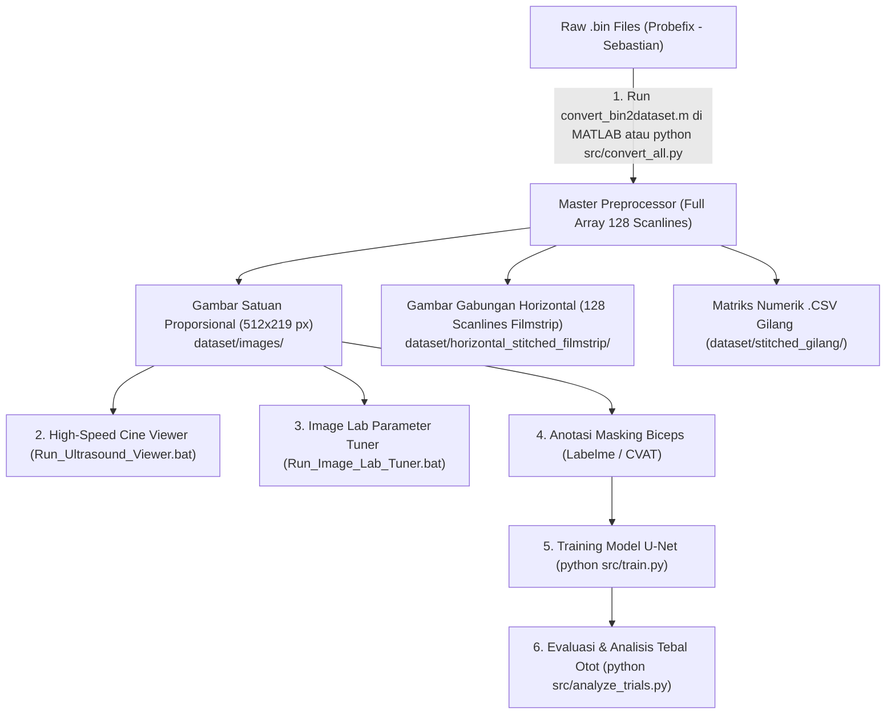

# Biceps Brachii Ultrasound Segmentation Pipeline (Probefix - Sebastian)

Deep learning segmentation, cine viewing, and muscle thickness quantification for **Biceps Brachii** using ArtUs / Telemed L12-5N40-A4 Full-Array Linear Ultrasound (128 scanlines, 38.4 mm aperture x 89.96 mm depth).

---

## 📌 Workflow Architecture



---

## 🚀 Dataset Specifications (L12-5N40-A4)

* **Probe Transduser**: Telemed L12-5N40-A4 (Linear Array 12–5 MHz, 128 elements).
* **Aperture Lebar**: **38.4 mm** (128 scanlines).
* **Kedalaman Maksimal**: **89.96 mm** (4673 sampel aksial, sampling 25 ns).
* **Dimensi Citra Satuan**: $512\text{ px tinggi} \times 219\text{ px lebar}$ (1 px = $0.1757\text{ mm}$).
* **Subjects**:
  1. `Azmi_-_RM_10`: 858 frame (10.3 detik @ 83.1 FPS)
  2. `Tissa_-_10RM`: 918 frame (18.4 detik @ 50.0 FPS)

---

## 🛠️ Step-by-Step Execution Guide

### Langkah 1: Preprocessing di MATLAB atau Python
Buka MATLAB dan jalankan:
```matlab
run('convert_bin2dataset.m')
```
Atau via terminal Python:
```bash
python src/convert_all.py
```

### Langkah 2: Inspeksi Visual (High-Speed Cine Viewer)
Dobel-klik file:
👉 **`Run_Ultrasound_Viewer.bat`**
* Tahan tombol **Panah Kanan (`→`) / Kiri (`←`)** untuk memutar frame secara instan tanpa lag pada 60–120 FPS.

### Langkah 3: Tuning Parameter Citra HD (Image Lab Tuner)
Dobel-klik file:
👉 **`Run_Image_Lab_Tuner.bat`**
* Geser slider *Rejection*, *Sharpening*, dan *CLAHE* secara real-time.
* Klik **"Save to MATLAB & Config"** untuk memperbarui parameter ke seluruh sistem.

### Langkah 4: Anotasi Ground Truth & Training Model AI
```bash
# 1. Anotasi frame satuan di dataset/images/ menggunakan Labelme
labelme

# 2. Latih model segmentasi
python src/train.py

# 3. Analisis serial ketebalan otot
python src/analyze_trials.py
```
