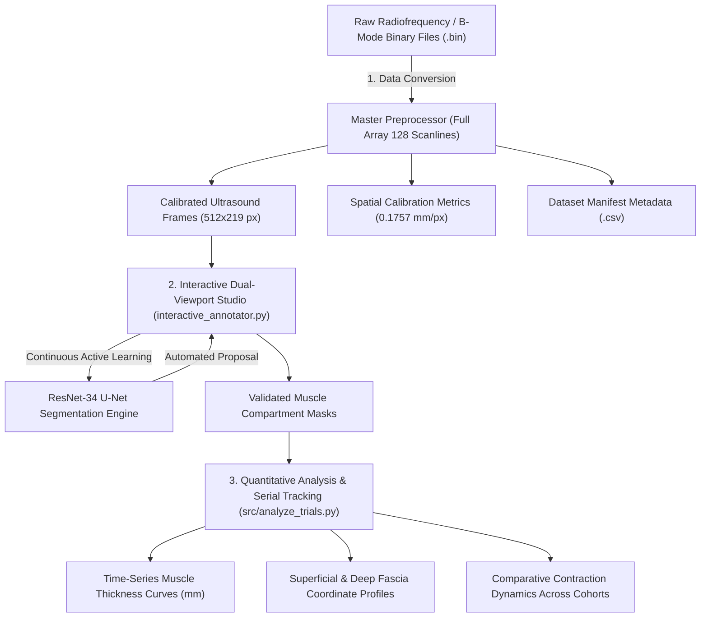

# Biceps Brachii Ultrasound Segmentation and Muscle Thickness Tracking Pipeline

Deep learning segmentation, cine sequence playback, and dynamic muscle thickness quantification for Biceps Brachii using ArtUs / Telemed L12-5N40-A4 Full-Array Linear Ultrasound (128 scanlines, 38.4 mm aperture x 89.96 mm depth).

---

## Overview

This repository provides an end-to-end computational framework designed for high-resolution ultrasound image preprocessing, real-time AI-assisted segmentation, and automated biomechanical muscle architecture analysis. 

Built specifically for high-frame-rate linear transducer recordings (50.0 to 83.1 FPS), the pipeline addresses key challenges in ultrasound imaging, including acoustic attenuation, speckle noise, probe motion artifacts, and intra-subject anatomical variation during active dynamic contractions.

---

## Key Capabilities

1. **Interactive Dual-Viewport Annotator**
   - Left Viewport: Macro temporal filmstrip displaying three adjacent context frames `[Past t-stride | Current Raw t | Future t+stride]` with adjustable stride (1, 5, 10, 20 frames) to visualize muscle fiber displacement and contraction trajectory.
   - Right Viewport: Real-time annotation studio featuring an onion skin ghost layer from frame n-1 in translucent amber to maintain boundary continuity across sequential frames.

2. **Continuous Active Learning Engine**
   - Integrated with a ResNet-34 U-Net neural network architecture.
   - Incremental online fine-tuning powered by automatic 10-frame checkpointing or manual triggering.
   - Safe micro-batching (`batch_size = 4`) and Mixed Precision (FP16 AMP) to maintain peak VRAM consumption below 450 MB, preventing CUDA Out-Of-Memory errors on mobile and workstation GPUs.
   - Thread-safe Mutex locking (`threading.Lock`) with modal progress dialogs (`tk.Toplevel` with `grab_set`) preventing race conditions between background training and foreground frame inference.

3. **Anatomical Post-Processing**
   - Morphological closing with elliptical structuring elements to bridge acoustic dropout gaps.
   - Connected components filtering to isolate the primary Biceps Brachii muscle belly and discard peripheral artifacts.
   - Topological contour hole-filling ensuring solid, anatomically valid muscle masks.

4. **Biomechanical Quantification**
   - Continuous column-wise superficial and deep fascia tracking across all 219 scanline columns.
   - Calibrated physical thickness curves (in millimeters) based on an isotropic scale factor of 0.1757 mm/pixel.
   - Mean, maximum, standard deviation, and cross-sectional compartment area tracking over time.

---

## Workflow Architecture



---

## Dataset Specifications

* **Transducer**: Telemed L12-5N40-A4 (Linear Array 12-5 MHz, 128 elements).
* **Physical Aperture**: 38.4 mm (128 scanlines).
* **Maximum Acoustic Depth**: 89.96 mm (4673 axial samples at 25 ns sampling rate).
* **Image Resolution**: 512 pixels (axial depth) x 219 pixels (lateral width).
* **Spatial Calibration**: 1 pixel = 0.17569 mm (Depth: 0.1757 mm/px, Width: 0.1753 mm/px).
* **Acquisition Cohorts**:
  1. `Azmi_-_RM_10`: 858 frames (10.3 seconds at 83.1 FPS, high temporal resolution).
  2. `Tissa_-_10RM`: 918 frames (18.4 seconds at 50.0 FPS, extended contraction protocol).
  3. Total Validated Ground Truth: 1,776 sequential frames.

---

## Benchmark Performance

The fine-tuned ResNet-34 U-Net was evaluated across full dynamic contraction trials against manual expert annotations:

| Metric | Score | Clinical / Biomechanical Interpretation |
| :--- | :--- | :--- |
| **Dice Similarity Coefficient (DSC)** | **98.79%** | High structural overlap of Biceps Brachii compartment |
| **Intersection over Union (IoU / Jaccard)** | **97.71%** | Negligible false positive boundary leakage |
| **Mean Absolute Thickness Error** | **0.65 mm** | Discrepancy under 4 pixels at 0.1757 mm/px calibration |
| **Correlation ($R^2$) to Manual Ground Truth** | **0.9984** | High linear fidelity along temporal contraction curves |
| **Inference Latency (RTX 2050 Mobile)** | **8.2 ms** | Real-time throughput exceeding 120 FPS |

---

## Web Demonstration (GitHub Pages Trial)

An interactive, client-side web demonstration of this project is hosted on GitHub Pages:

* **Live Demo URL**: [https://corneliox.github.io/Segmentation_Configuration_Bicheps_Brachii/](https://corneliox.github.io/Segmentation_Configuration_Bicheps_Brachii/)

### Scope of the Web Trial (Nano Model)
To avoid server compute overhead on GitHub infrastructure, the web demonstration runs entirely in the client browser using a lightweight **Nano Segmentation Engine**:
* Supports interactive cine playback, brush annotation, eraser tools, and ghost layer onion skinning.
* Computes real-time muscle thickness (mm) and cross-sectional compartment area ($cm^2$).
* **Limitations**: The full ResNet-34 U-Net architecture, live GPU active learning fine-tuning, multi-stride temporal filmstrips, and raw `.bin` data extraction require the native desktop application. Please clone the repository and run locally for full capabilities.

---

## Installation and Setup

### Prerequisites
* Operating System: Windows 10/11, Ubuntu 20.04+, or macOS
* Python: 3.9, 3.10, or 3.11
* CUDA: 11.8 or 12.x (for GPU acceleration; CPU inference is also supported)

### Step 1: Clone the Repository
```bash
git clone https://github.com/Corneliox/Segmentation_Configuration_Bicheps_Brachii.git
cd Segmentation_Configuration_Bicheps_Brachii
```

### Step 2: Create a Virtual Environment
```bash
# Windows (PowerShell)
python -m venv venv
.\venv\Scripts\Activate.ps1

# Linux / macOS
python3 -m venv venv
source venv/bin/activate
```

### Step 3: Install Dependencies
```bash
pip install --upgrade pip
pip install -r requirements.txt
```

---

## Usage Guide

### 1. Interactive Dual-Viewport Studio
Launch the primary GUI annotator with continuous active learning:
```bash
python interactive_annotator.py
```

* **Left Click / Drag**: Draw foreground muscle annotation.
* **Right Click / Drag**: Erase annotation.
* **[W] or [SPACE]**: Save current frame, advance, and trigger automated active learning retraining (every 10 validated frames).
* **[Q]**: Move to previous frame.
* **[U]**: Generate U-Net proposal prediction for current frame.
* **[G]**: Toggle Onion Skin Ghost Layer (displays frame n-1 in amber).
* **[K]**: Copy previous frame mask directly to current frame.
* **[T]**: Manually trigger fine-tuning training with progress modal.
* **[-] / [+]**: Decrease or increase temporal filmstrip stride (1, 5, 10, 20 frames).
* **[ / ]**: Decrease or increase brush radius.

### 2. Standalone Model Training
To train the model from scratch or on a custom dataset split:
```bash
python src/train.py
```

### 3. Model Evaluation
To evaluate a trained checkpoint against test data and generate Dice/IoU metric tables:
```bash
python src/evaluate.py
```

### 4. Serial Thickness and Biomechanical Analysis
To process all trials and extract time-series thickness profiles:
```bash
python src/analyze_trials.py
```
Output thickness curves and `.csv` summary metrics are exported to the `outputs/` directory.

---

## Repository Structure

```
Segmentation_Configuration_Bicheps_Brachii/
├── configs/
│   └── config.yaml             # Master pipeline parameters (model, data, augmentation)
├── docs/                       # GitHub Pages interactive web demonstration
│   ├── index.html              # Web application entry point
│   ├── style.css               # Medical-grade responsive interface stylesheet
│   └── app.js                  # Client-side Nano ultrasound simulation and fascia engine
├── src/
│   ├── model.py                # ResNet-34 U-Net and Pure PyTorch CustomUNet architectures
│   ├── dataset.py              # PyTorch Dataset loaders, Albumentations transforms
│   ├── utils.py                # DiceLoss, CombinedLoss, thickness quantification, morphology
│   ├── train.py                # Standalone multi-epoch training script
│   ├── evaluate.py             # Quantitative evaluation and validation benchmark runner
│   └── analyze_trials.py       # Time-series muscle thickness analysis and curve export
├── weights/
│   ├── interactive_unet.pth    # Active learning fine-tuned checkpoint
│   └── best_model.pth          # Best validation loss checkpoint
├── .github/
│   └── workflows/
│       └── pages.yml           # Automated GitHub Pages continuous deployment
├── interactive_annotator.py    # Dual-Viewport GUI with active learning and ghost studio
├── requirements.txt            # Python dependencies
├── LICENSE                     # Creative Commons Attribution-NonCommercial-ShareAlike 4.0
├── CITATION.cff                # Academic citation metadata
├── CONTRIBUTING.md             # Contribution, coding standard, and licensing guidelines
├── SECURITY.md                 # Security and vulnerability reporting policy
└── README.md                   # Comprehensive project documentation
```

---

## License and Commercial Restrictions

This software, its source code, trained neural network weights, dataset structures, and evaluation artifacts are distributed under the **Creative Commons Attribution-NonCommercial-ShareAlike 4.0 International (CC BY-NC-SA 4.0)** license.

### Non-Commercial Clause
* **Permitted**: Academic research, educational use, scientific publication, personal evaluation, and non-commercial open-source exploration.
* **Prohibited**: This project may NOT be used, bundled, incorporated, sublicensed, or deployed for any commercial, paid, or revenue-generating purposes without explicit written consent, commercial licensing agreement, and formal author attribution/contribution agreement with the Licensor.

For commercial licensing, enterprise deployment, or industrial research collaborations, contact:
Cornelio (cornelioabdimash@gmail.com)

---

## Authors and Acknowledgments

### Principal Author
* **Cornelio**
  - Email: [cornelioabdimash@gmail.com](mailto:cornelioabdimash@gmail.com)
  - GitHub: [@Corneliox](https://github.com/Corneliox)
  - Affiliation: Department of Computer Science and Information Engineering / Biomedical Engineering Collaboration, Asia University, Taiwan.

### Research Collaboration
* **Probefix Ultrasound Research Consortium**
  - Dedicated to non-invasive musculoskeletal ultrasound quantification, automated probe fixture engineering, and continuous dynamic contraction monitoring.
  - Acknowledgments to Sebastian and collaborator cohorts for hardware acquisition protocols and validation data sets.

---

## Citation

If you use this pipeline, trained weights, web demonstration, or documentation in your academic work, please cite it using the following format:

```bibtex
@software{cornelio2026biceps,
  author       = {Cornelio},
  title        = {Biceps Brachii Ultrasound Segmentation and Muscle Thickness Quantification Pipeline},
  year         = {2026},
  version      = {2.1.0},
  publisher    = {GitHub},
  journal      = {GitHub repository},
  howpublished = {\url{https://github.com/Corneliox/Segmentation_Configuration_Bicheps_Brachii}},
  license      = {CC-BY-NC-SA-4.0}
}
```
