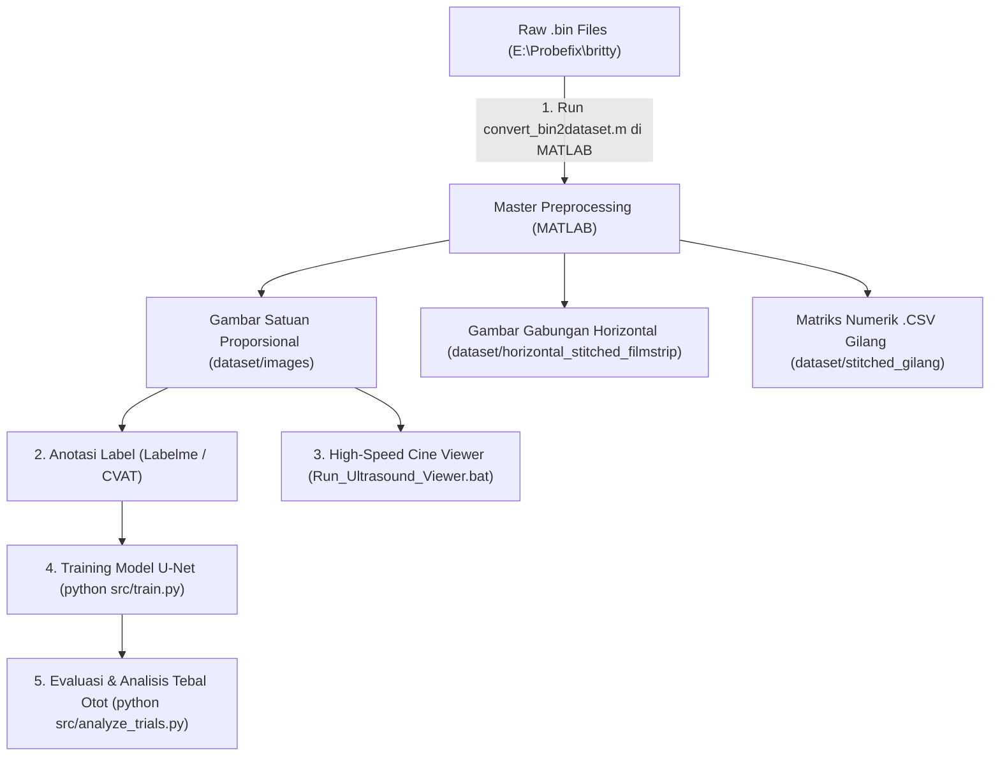

# Biceps Brachii Ultrasound Segmentation Pipeline

Automated deep learning segmentation, cine viewing, and muscle thickness quantification for **Biceps Brachii** from ArtUs/Telemed B-Mode ultrasound data.

---

## 📌 Complete Workflow Architecture



---

## 🚀 Step-by-Step Execution Guide

### Langkah 1: Preprocessing di MATLAB (Master Preprocessor)
Buka MATLAB dan jalankan skrip konversi utama:
```matlab
run('E:\Probefix\Segmentation_Configuration\matlab_converter\convert_bin2dataset.m')
```
Skrip ini otomatis menghasilkan:
1. **Gambar Satuan Proporsional ($512 \times 89$ px)** di `dataset/images/{5rm, 10rm}/{trial}/frame_XXXX.png` untuk anotasi.
2. **Gambar Gabungan Horizontal (Merger Raw 33-Scanlines)** di `dataset/horizontal_stitched_filmstrip/` untuk inspeksi serial penuh.
3. **Data CSV & M-Mode Gilang** di `dataset/stitched_gilang/` untuk kompatibilitas stiffness.

---

### Langkah 2: Inspeksi Visual Cepat (High-Speed Cine Viewer)
Dobel-klik file batch:
👉 **[`E:\Probefix\Run_Ultrasound_Viewer.bat`](file:///e:/Probefix/Run_Ultrasound_Viewer.bat)**
* Tahan tombol **Panah Kanan (`→`) / Kiri (`←`)** untuk memutar urutan frame secara instan tanpa lag/buffering pada 60–120 FPS.
* Tekan **Spasi** untuk play/pause otomatis.

---

### Langkah 3: Anotasi Masking Biceps Brachii
1. Jalankan Labelme:
   ```bash
   pip install labelme
   labelme
   ```
2. Buka folder citra satuan di `dataset/images/` dan buat poligon mask untuk Biceps Brachii.
3. Simpan mask ke dalam `dataset/masks/` dengan struktur nama yang sama.

---

### Langkah 4: Training & Evaluasi Model AI
```bash
cd E:\Probefix\Segmentation_Configuration
pip install -r requirements.txt

# Latih model segmentasi
python src/train.py

# Evaluasi & ekstrak kurva ketebalan otot sepanjang waktu rekaman
python src/analyze_trials.py
```
Hasil grafik kurva tebal otot dan perbandingan 5RM vs 10RM akan tersimpan otomatis di `outputs/trial_analysis/`.
